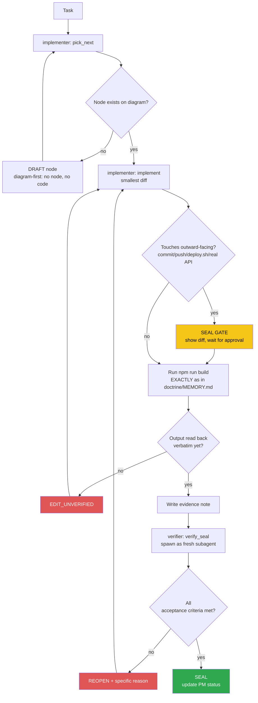

<!-- Diagram: dev-loop -->
<!-- Dev loop: plan - implement - verify - seal -->
DNA: 'smallest_diff / edit_x_read_back_proof_x_independent_verdict'
Auth: 65537 | Version: 1.0.0
Law: LAI-13 - monotonic ratchet (PENDING -> IN_PROGRESS -> SEALED, never demote)

> Every change to the code repo enters here and exits as SEALED or
> REOPENED — no state in between.

> **Language note:** rows below dated before 2026-08-22 are written in
> Vietnamese (historical record, kept verbatim per the no-rewrite evidence
> rule). New rows from 2026-08-22 onward are written in English — see
> `NORTHSTAR.md` → Language & token policy.

## PM status
> Older SEALED nodes (2026-08-20 through 2026-08-25, 41 nodes; then a 2nd
> pass 2026-08-30 covering 7 more nodes dated 2026-08-29; then a 3rd pass
> 2026-09-03 covering every remaining full-content SEALED row, 14 nodes
> dated 2026-08-30 through 2026-09-02; then a 4th pass 2026-09-06 covering
> the 2 nodes dated 2026-09-05, `issue-63-account-settings-page` and
> `issue-61-forgot-reset-password`) moved to
> `haven/diagrams/dev-loop-archive.md` to keep this file small — every
> worker session reads this file in full. Nothing deleted: the archive
> has each row's full original text verbatim. The compact rows below
> point to it; open the archive only when you need the full story
> behind an old node. `pick_next` only needs non-archived rows. Run
> `/hub-tokens` periodically — if this file flags >15KB again, repeat
> this archiving pass for nodes older than the current work session.
> [note, 3rd pass] after this pass the active file is still ~17.8KB, over
> the 15KB threshold — every remaining SEALED row is now a pointer, the
> only full-content rows left are the 5 non-SEALED nodes (never
> archived per LAI-13/the rule above); further reduction isn't possible
> through archiving alone.
> [note, 4th pass] same limitation as the 3rd pass's note — the 5
> non-SEALED nodes are the floor, every SEALED row is already a pointer
> again after this pass.

| Node | State | Notes |
|---|---|---|

| `issue-122-ai-cv-suggestions-pending` | PENDING | Operator (2026-10-05): "#122 chuyển status thành PENDING". Deliberately deferred, not started — waiting on an owner decision: shared app AI key vs BYOK (BYOK needs new two-way encryption on the backend; only `bcrypt` exists today) + a consent checkbox for sending CV data out. Checked: no branch/PR/evidence for #122; backend `origin/staging` (`f05930a`) has no AI-provider code. Partly overlapped by #159's non-AI JD keyword match. GitHub label `status: pending` applied. Evidence: `evidence/implementer/2026-10-05-issue-122-158-status-rows.md`. |

Any regression must be a **new node** (LAI-13) — never edit an old node's
PM status directly to "undo" an existing SEAL.
| `issue-307-modal-save-close` | SEALED | 2026-10-25 — archived, see `haven/diagrams/dev-loop-archive.md`. Evidence: `evidence/verifier/2026-10-25-issue-307-modal-save-close-seal.md`. |
| `issue-316-404-page` | SEALED | 2026-10-25 — archived, see dev-loop-archive.md. Evidence: `evidence/verifier/2026-10-25-issue-316-404-page-seal.md` |
| `issue-315-user-menu-label` | SEALED | 2026-10-25 — archived, see `haven/diagrams/dev-loop-archive.md`. Evidence: `evidence/verifier/2026-10-25-issue-315-user-menu-label-seal.md`. |
| `issue-314-public-cv-slug-reload` | SEALED | 2026-10-25 — archived, see `haven/diagrams/dev-loop-archive.md`. Evidence: `evidence/verifier/2026-10-25-issue-314-public-cv-slug-reload-seal.md`. |
| `issue-311-redundant-requests` | SEALED | 2026-10-25 — archived, see `haven/diagrams/dev-loop-archive.md`. Evidence: `evidence/verifier/2026-10-25-issue-311-redundant-requests-seal.md`. |
| `issue-312-load-login-errors` | SEALED | 2026-10-25 — archived, see dev-loop-archive.md. Evidence: `evidence/verifier/2026-10-25-issue-312-load-login-errors-seal.md` |
| `issue-310-toast-language` | SEALED | 2026-10-25 — archived, see `haven/diagrams/dev-loop-archive.md`. Evidence: `evidence/verifier/2026-10-25-issue-310-toast-language-seal.md`. |
| `issue-317-reload-redirect` | SEALED | 2026-10-25 — archived, see dev-loop-archive.md. Evidence: `evidence/verifier/2026-10-25-issue-317-reload-redirect-seal.md` |
| `issue-336-social-media-update` | SEALED | 2026-10-26 — archived, see dev-loop-archive.md. Evidence: `evidence/verifier/2026-10-26-issue-336-social-media-update-seal.md` |
| `issue-340-input-cannot-clear` | SEALED | 2026-10-26 — archived, see dev-loop-archive.md. Evidence: `evidence/verifier/2026-10-26-issue-340-input-cannot-clear-seal.md` |
| `issue-344-reload-empty-form` | SEALED | 2026-10-26 — archived, see dev-loop-archive.md. Evidence: `evidence/verifier/2026-10-26-issue-344-reload-empty-form-seal.md` |
| `issue-335-register-names` | SEALED | 2026-10-26 — archived, see dev-loop-archive.md. Evidence: `evidence/verifier/2026-10-26-issue-335-register-names-seal.md` |
| `issue-312-load-error-retry` | SEALED | 2026-10-26 — archived, see dev-loop-archive.md. Evidence: `evidence/verifier/2026-10-26-issue-312-load-error-retry-seal.md` |
| `issue-312-visits-error-retry` | SEALED | 2026-10-27 — archived, see dev-loop-archive.md. Evidence: `evidence/verifier/2026-10-27-issue-312-visits-error-retry-seal.md` |
| `issue-355-education-major-min` | SEALED | 2026-10-31 — archived, see dev-loop-archive.md. Evidence: `evidence/verifier/2026-10-31-issue-355-education-major-min-seal.md` |
| `issue-347-veeform-hidden-lang-flag` | SEALED | 2026-10-31 — archived, see dev-loop-archive.md. Evidence: `evidence/verifier/2026-10-31-issue-347-veeform-hidden-lang-flag-seal.md` |
| `issue-352-import-modal-close` | SEALED | 2026-10-31 — archived, see dev-loop-archive.md. Evidence: `evidence/verifier/2026-10-31-issue-352-import-modal-close-seal.md` |
| `issue-353-stale-header-email` | SEALED | 2026-10-31 — archived, see dev-loop-archive.md. Evidence: `evidence/verifier/2026-10-31-issue-353-stale-header-email-seal.md` |
| `issue-354-public-cv-experience-order` | SEALED | 2026-10-31 — archived, see dev-loop-archive.md. Evidence: `evidence/verifier/2026-10-31-issue-354-public-cv-experience-order-seal.md` |
| `issue-356-editor-datepicker-i18n` | SEALED | 2026-10-31 — archived, see dev-loop-archive.md. Evidence: `evidence/verifier/2026-10-31-issue-356-editor-datepicker-i18n-seal.md` |
| `issue-364-form-length-rules` | SEALED | 2026-10-31 — archived, see dev-loop-archive.md. Evidence: `evidence/verifier/2026-10-31-issue-364-form-length-rules-seal.md` |
