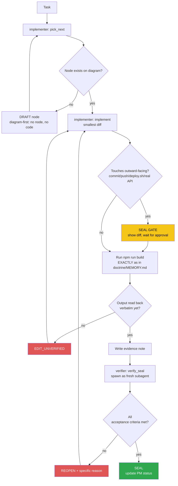

<!-- Diagram: dev-loop -->
<!-- Dev loop: plan - implement - verify - seal -->
DNA: 'smallest_diff / edit_x_read_back_proof_x_independent_verdict'
Auth: 65537 | Version: 1.0.0
Law: LAI-13 - monotonic ratchet (PENDING -> IN_PROGRESS -> SEALED, never demote)

> Every change to the code repo enters here and exits as SEALED or
> REOPENED — no state in between.

> **Language note:** rows below dated before 2026-08-22 are written in
> Vietnamese (historical record, kept verbatim per the no-rewrite evidence
> rule). New rows from 2026-08-22 onward are written in English — see
> `NORTHSTAR.md` → Language & token policy.

## PM status
> Older SEALED nodes (2026-08-20 through 2026-08-25, 41 nodes; then a 2nd
> pass 2026-08-30 covering 7 more nodes dated 2026-08-29; then a 3rd pass
> 2026-09-03 covering every remaining full-content SEALED row, 14 nodes
> dated 2026-08-30 through 2026-09-02; then a 4th pass 2026-09-06 covering
> the 2 nodes dated 2026-09-05, `issue-63-account-settings-page` and
> `issue-61-forgot-reset-password`) moved to
> `haven/diagrams/dev-loop-archive.md` to keep this file small — every
> worker session reads this file in full. Nothing deleted: the archive
> has each row's full original text verbatim. The compact rows below
> point to it; open the archive only when you need the full story
> behind an old node. `pick_next` only needs non-archived rows. Run
> `/hub-tokens` periodically — if this file flags >15KB again, repeat
> this archiving pass for nodes older than the current work session.
> [note, 3rd pass] after this pass the active file is still ~17.8KB, over
> the 15KB threshold — every remaining SEALED row is now a pointer, the
> only full-content rows left are the 5 non-SEALED nodes (never
> archived per LAI-13/the rule above); further reduction isn't possible
> through archiving alone.
> [note, 4th pass] same limitation as the 3rd pass's note — the 5
> non-SEALED nodes are the floor, every SEALED row is already a pointer
> again after this pass.

| Node | State | Notes |
|---|---|---|

| `issue-122-ai-cv-suggestions-pending` | PENDING | Operator (2026-10-05): "#122 chuyển status thành PENDING". Deliberately deferred, not started — waiting on an owner decision: shared app AI key vs BYOK (BYOK needs new two-way encryption on the backend; only `bcrypt` exists today) + a consent checkbox for sending CV data out. Checked: no branch/PR/evidence for #122; backend `origin/staging` (`f05930a`) has no AI-provider code. Partly overlapped by #159's non-AI JD keyword match. GitHub label `status: pending` applied. Evidence: `evidence/implementer/2026-10-05-issue-122-158-status-rows.md`. |
| `issue-221-table-default` | SEALED | 2026-10-19 — archived, see `haven/diagrams/dev-loop-archive.md`. Evidence: `evidence/verifier/2026-10-19-issue-221-table-default-seal.md`. |
| `issue-222-forms` | SEALED | 2026-10-19 — archived, see `haven/diagrams/dev-loop-archive.md`. Evidence: `evidence/verifier/2026-10-19-issue-222-forms-seal.md`. |
| `issue-223-crud-lists` | SEALED | 2026-10-19 — archived, see `haven/diagrams/dev-loop-archive.md`. Evidence: `evidence/verifier/2026-10-19-issue-223-crud-lists-seal.md`. |
| `issue-224-remaining-pages` | SEALED | 2026-10-19 — archived, see `haven/diagrams/dev-loop-archive.md`. Evidence: `evidence/verifier/2026-10-19-issue-224-remaining-pages-r3-seal.md`. |
| `issue-235-career-break` | SEALED | 2026-10-19 — archived, see `haven/diagrams/dev-loop-archive.md`. Evidence: `evidence/verifier/2026-10-19-issue-235-career-break-r2-seal.md`. |
| `issue-211-epic-review` | SEALED | 2026-10-20 — archived, see `haven/diagrams/dev-loop-archive.md`. Evidence: `evidence/verifier/2026-10-20-issue-211-epic-review-r2-seal.md`. |
| `issue-249-experience-unsaved-warning` | SEALED | 2026-10-20 — archived, see `haven/diagrams/dev-loop-archive.md`. Evidence: `evidence/implementer/2026-10-20-issue-249-experience-unsaved-warning.md`. |
| `issue-251-header-language-switch` | SEALED | 2026-10-20 — archived, see `haven/diagrams/dev-loop-archive.md`. Evidence: `evidence/implementer/2026-10-20-issue-251-header-language-switch.md`. |
| `issue-251-lang-switch-left-tooltip` | SEALED | 2026-10-20 — archived, see `haven/diagrams/dev-loop-archive.md`. Evidence: `evidence/implementer/2026-10-20-issue-251-lang-switch-left-tooltip.md`. |
| `issue-251-ci-lockfile` | SEALED | 2026-10-21 — archived, see `haven/diagrams/dev-loop-archive.md`. Evidence: `evidence/implementer/2026-10-21-issue-251-ci-lockfile.md`. |
| `issue-260-texteditor-list-style` | SEALED | 2026-10-21 — archived, see `haven/diagrams/dev-loop-archive.md`. Evidence: `evidence/implementer/2026-10-21-issue-260-texteditor-list-style.md`. |
| `issue-262-cv-lang-cleanup` | SEALED | 2026-10-21 — archived, see `haven/diagrams/dev-loop-archive.md`. Evidence: `evidence/verifier/2026-10-21-issue-262-cv-lang-cleanup-seal.md`. |

| `issue-266-i18n-phase1-shared-auth` | SEALED | 2026-10-21 — archived, see `haven/diagrams/dev-loop-archive.md`. Evidence: `evidence/verifier/2026-10-21-issue-266-i18n-phase1-shared-auth-seal.md`. |
| `issue-271-cold-start-overlay` | SEALED | 2026-10-21 — archived, see `haven/diagrams/dev-loop-archive.md`. Evidence: see archived row. |
| `issue-252-api-response-standard` | SEALED | 2026-10-21 — archived, see `haven/diagrams/dev-loop-archive.md`. Evidence: see archived row. |

Any regression must be a **new node** (LAI-13) — never edit an old node's
PM status directly to "undo" an existing SEAL.
| `issue-281-experience-add-type` | SEALED | 2026-10-21 — archived, see `haven/diagrams/dev-loop-archive.md`. Evidence: `evidence/verifier/2026-10-21-issue-281-experience-add-type-seal.md`. |
| `issue-266-i18n-dashboard-browser-check` | SEALED | 2026-10-24 — archived, see `haven/diagrams/dev-loop-archive.md`. Evidence: `evidence/verifier/2026-10-24-issue-266-i18n-dashboard-browser-check-seal.md`. |
| `issue-291-download-cv` | SEALED | 2026-10-24 — archived, see `haven/diagrams/dev-loop-archive.md`. Evidence: `evidence/verifier/2026-10-24-issue-291-download-cv-seal.md`. |
| `issue-295-typecheck-script` | SEALED | 2026-10-24 — archived, see dev-loop-archive.md. Evidence: `evidence/verifier/2026-10-24-issue-295-typecheck-script-seal.md` |
| `issue-308-visits-count` | SEALED | 2026-10-25 — archived, see dev-loop-archive.md. Evidence: `evidence/verifier/2026-10-25-issue-308-visits-count-seal.md` |
| `issue-307-modal-save-close` | SEALED | 2026-10-25 — archived, see `haven/diagrams/dev-loop-archive.md`. Evidence: `evidence/verifier/2026-10-25-issue-307-modal-save-close-seal.md`. |
