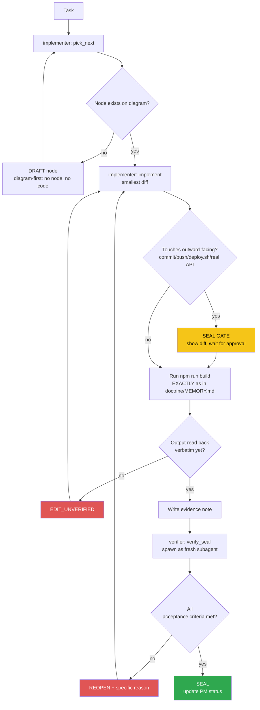

<!-- Diagram: dev-loop -->
<!-- Dev loop: plan - implement - verify - seal -->
DNA: 'smallest_diff / edit_x_read_back_proof_x_independent_verdict'
Auth: 65537 | Version: 1.0.0
Law: LAI-13 - monotonic ratchet (PENDING -> IN_PROGRESS -> SEALED, never demote)
States: PENDING, IN_PROGRESS, BLOCKED_<reason> (<-> IN_PROGRESS), SEALED (verifier only, final). REOPEN is a verdict (row stays IN_PROGRESS); DRAFT is creating a row (lands PENDING).

> Every change to the code repo enters here and exits as SEALED; a
> REOPEN verdict sends it back to implement, still IN_PROGRESS.

> **Language note:** rows below dated before 2026-08-22 are written in
> Vietnamese (historical record, kept verbatim per the no-rewrite evidence
> rule). New rows from 2026-08-22 onward are written in English — see
> `NORTHSTAR.md` → Language & token policy.

## PM status
> Older SEALED nodes (2026-08-20 through 2026-08-25, 41 nodes; then a 2nd
> pass 2026-08-30 covering 7 more nodes dated 2026-08-29; then a 3rd pass
> 2026-09-03 covering every remaining full-content SEALED row, 14 nodes
> dated 2026-08-30 through 2026-09-02; then a 4th pass 2026-09-06 covering
> the 2 nodes dated 2026-09-05, `issue-63-account-settings-page` and
> `issue-61-forgot-reset-password`) moved to
> `haven/diagrams/dev-loop-archive.md` to keep this file small — every
> worker session reads this file in full. Nothing deleted: the archive
> has each row's full original text verbatim. The compact rows below
> point to it; open the archive only when you need the full story
> behind an old node. `pick_next` only needs non-archived rows. Run
> `/hub-health` periodically — if this file flags >15KB again, repeat
> this archiving pass for nodes older than the current work session.
> [note, 3rd pass] after this pass the active file is still ~17.8KB, over
> the 15KB threshold — every remaining SEALED row is now a pointer, the
> only full-content rows left are the 5 non-SEALED nodes (never
> archived per LAI-13/the rule above); further reduction isn't possible
> through archiving alone.
> [note, 4th pass] same limitation as the 3rd pass's note — the 5
> non-SEALED nodes are the floor, every SEALED row is already a pointer
> again after this pass.
>
> Any regression must be a **new node** (LAI-13) — never edit an old node's
> PM status directly to "undo" an existing SEAL.
>
> The table below is the LAST block of this file: a new row is appended
> at end-of-file (`AppendOnly`), a removed row is deleted with its line —
> no blank lines, no text after the table.

| Node | State | Notes |
|---|---|---|
| `issue-122-ai-cv-suggestions-pending` | PENDING | Operator (2026-10-05): "#122 chuyển status thành PENDING". Deliberately deferred, not started — waiting on an owner decision: shared app AI key vs BYOK (BYOK needs new two-way encryption on the backend; only `bcrypt` exists today) + a consent checkbox for sending CV data out. Checked: no branch/PR/evidence for #122; backend `origin/staging` (`f05930a`) has no AI-provider code. Partly overlapped by #159's non-AI JD keyword match. GitHub label `status: pending` applied. Evidence: `evidence/implementer/2026-10-05-issue-122-158-status-rows.md`. |
| `issue-455-format-by-app-lang` | SEALED | 2026-11-18 — archived, see dev-loop-archive.md. Evidence: `evidence/verifier/2026-11-18/issue-455-format-by-app-lang-seal.md` |
| `issue-400-experience-view-lang` | SEALED | 2026-11-19 — archived, see dev-loop-archive.md. Evidence: `evidence/verifier/2026-11-19/issue-400-experience-view-lang-seal.md` |
| `issue-402-project-view-modal` | SEALED | 2026-11-19 — archived, see dev-loop-archive.md. Evidence: `evidence/verifier/2026-11-19/issue-402-project-view-modal-seal.md` |
| `issue-419-table-row-keys` | SEALED | 2026-11-20 — archived, see dev-loop-archive.md. Evidence: `evidence/verifier/2026-11-20/issue-419-table-row-keys-seal.md` |
| `issue-489-typed-delete-confirm` | SEALED | 2026-11-20 — archived, see dev-loop-archive.md. Evidence: evidence/verifier/2026-11-20/issue-489-typed-delete-confirm-seal.md |
| `issue-421-451-export-json` | SEALED | 2026-11-21 — archived, see dev-loop-archive.md. Evidence: `evidence/verifier/2026-11-21/issue-421-451-export-json-seal.md` |
| `issue-432-433-personal-info-select` | SEALED | 2026-11-21 — archived, see dev-loop-archive.md. Evidence: evidence/verifier/2026-11-21/issue-432-433-personal-info-select-seal.md |
| `issue-427-450-dev-host-pdf-lang` | SEALED | 2026-11-21 — archived, see dev-loop-archive.md. Evidence: evidence/verifier/2026-11-21/issue-427-450-dev-host-pdf-lang-seal.md |
| `issue-457-import-size-limit` | SEALED | 2026-11-21 — archived, see dev-loop-archive.md. Evidence: evidence/verifier/2026-11-21/issue-457-import-size-limit-seal.md |
| `issue-437-438-skills-stale-names` | SEALED | 2026-11-21 — archived, see dev-loop-archive.md. Evidence: evidence/verifier/2026-11-21/issue-437-438-skills-stale-names-seal.md |
| `issue-401-project-type-experience` | SEALED | 2026-11-21 — archived, see dev-loop-archive.md. Evidence: evidence/verifier/2026-11-21/issue-401-project-type-experience-seal.md |
| `issue-403-salary-range` | SEALED | 2026-11-21 — archived, see dev-loop-archive.md. Evidence: `evidence/verifier/2026-11-21/issue-403-salary-range-seal.md` |
| `issue-449-profile-stale-ids` | SEALED | 2026-11-22 — archived, see dev-loop-archive.md. Evidence: `evidence/verifier/2026-11-22/issue-449-profile-stale-ids-seal.md` |
| `issue-424-login-register-links` | SEALED | 2026-11-22 — archived, see dev-loop-archive.md. Evidence: `evidence/verifier/2026-11-22/issue-424-login-register-links-seal.md` |
| `issue-434-436-social-links-copy` | SEALED | 2026-11-22 — archived, see dev-loop-archive.md. Evidence: evidence/verifier/2026-11-22/issue-434-436-social-links-copy-seal.md |
| `issue-428-430-auth-redirects` | SEALED | 2026-11-22 — archived, see dev-loop-archive.md. Evidence: `evidence/verifier/2026-11-22/issue-428-430-auth-redirects-seal.md` |
| `issue-444-441-education-view-languages-edit` | SEALED | 2026-11-22 — archived, see dev-loop-archive.md. Evidence: `evidence/verifier/2026-11-22/issue-444-441-education-view-languages-edit-seal.md` |
| `issue-408-452-download-overlay-menu` | SEALED | 2026-11-23 — archived, see dev-loop-archive.md. Evidence: `evidence/verifier/2026-11-23/issue-408-452-download-overlay-menu-seal.md` |
| `issue-404-460-461-salary-password-ats` | SEALED | 2026-11-23 — archived, see dev-loop-archive.md. Evidence: `evidence/verifier/2026-11-23/issue-404-460-461-salary-password-ats-seal.md` |
| `issue-453-454-owner-visit-pagination` | SEALED | 2026-11-24 — archived, see dev-loop-archive.md. Evidence: `evidence/verifier/2026-11-24/issue-453-454-owner-visit-pagination-seal.md` |
